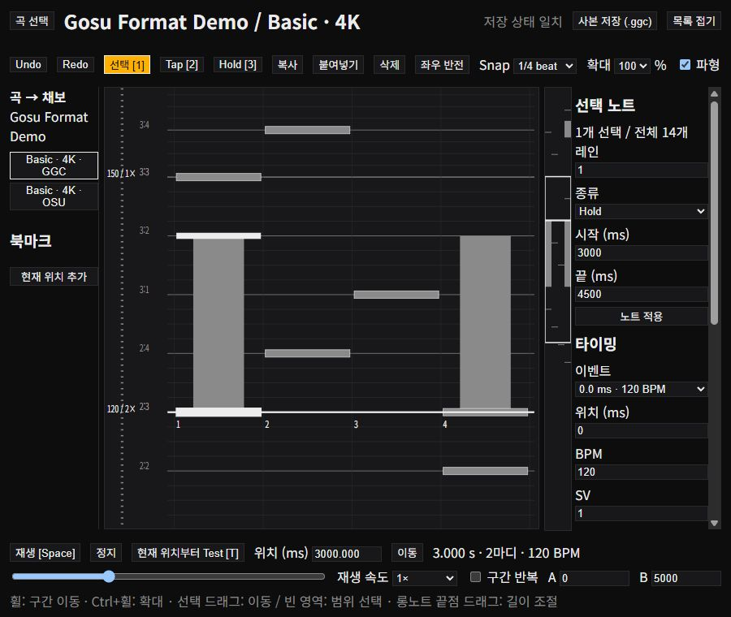

# 채보 Edit

곡 선택에서 채보를 고르고 **Edit**를 누른다. Wails와 웹에서 같은 화면·편집 모델을 사용한다.
키보드형 세로 레인을 중심으로 왼쪽 곡·채보 목록, 오른쪽 속성, 옆 미니맵, 하단 재생 조작을 둔다.
레인 폭·판정선 위치·노트 모양은 플레이 화면의 배치를 따른다. **Width**는 레인 폭만 배율로 바꾼다.
미니맵은 아래가 곡 시작, 위가 곡 끝으로 노트가 내려오는 방향과 같다.
기존 `layout.css`의 배치 속성과 `theme.css`의 색 변수 규칙을 유지한다.

## 조작

| 조작 | 동작 |
|---|---|
| 선택 / Tap / Hold, Q / W / E | 노트 선택, 클릭 입력, 드래그로 롱노트 입력 |
| 숫자 1–9, 0 | 현재 위치(Snap)의 1–10번 레인에 Tap 추가, 이미 있으면 삭제; 재생 중에도 동작 |
| 선택 노트 드래그 | 시간·레인 이동; Ctrl 클릭으로 복수 선택 |
| 빈 영역 드래그 | 레인·시간 범위의 노트 선택 |
| 선택한 LN 끝점 드래그 | 끝 시각 변경 |
| 속성 패널 값 변경 | 바로 적용 (Undo 한 단계); 노트 속성은 하나만 선택했을 때 표시 |
| Ctrl+C / X / V, Delete | 복사·잘라내기·현재 위치에 붙여넣기·삭제 (버튼 없음) |
| ↑ / ↓ | Snap 한 칸 위치 이동; Alt를 누르면 선택 노트도 함께 이동 |
| ← / →, Ctrl+휠, Shift+숫자 | Snap 단계 변경 / 해당 분할로 지정 |
| Alt+← / → | 선택 노트 레인 이동 |
| PageUp / PageDown, Home / End | 확대 단계 변경, 처음 / 끝 |
| + / − | 재생 속도 변경 |
| 좌우 반전 | 그룹별 반전 |
| Ctrl+Z / Shift+Ctrl+Z / Ctrl+Y | Undo / Redo; 최근 50개 작업 |
| 휠 | 위치 이동 |
| 채보 목록의 **옆** | 같은 곡의 다른 채보를 오른쪽에 읽기 전용으로 표시 |
| 위치 입력 후 Enter | 해당 원곡 시간으로 이동 |
| 미니맵 클릭 | 곡 전체에서 위치 선택 |
| Space, ▶/❚❚ | 재생·일시정지 (포커스와 무관; 텍스트 입력 중 제외) |
| ⏮ / ◀◀ / ▶▶ / ⏭ | 처음 / 이전 북마크 / 다음 북마크 / 끝 (Quaver EditorFooter 배치) |
| T, Test | 현재 위치부터 노트·오디오 미리보기; Esc로 종료 |

Snap의 분모는 **한 박**의 분할이다. 예: 1/4 beat는 4분음표 한 박의 4분할이다.
스크롤 배율 이벤트가 박 사이에 있어도 그리드 위상은 유지하고 BPM·정지에 따라 원곡 시각으로 변환한다.
확대와 재생 속도는 저장된 타임스탬프를 바꾸지 않는다. 재생 속도는 음악 음높이도 바꾼다.

## 속성과 검사

타이밍 패널에서 기존 이벤트의 시각·BPM·스크롤 배율·박자·정지를 바꾸고 현재 위치에 이벤트를 추가한다.
마지막 이벤트 하나는 삭제할 수 없다. 이벤트 변경은 노트의 절대 시각을 이동시키지 않는다.
따라서 타이밍을 바꾼 뒤 스냅 정렬과 패턴 위치를 확인해야 한다.

한 레인의 중복 노트·롱노트 겹침을 검사 목록에 표시하며 클릭하면 해당 위치로 이동한다.
문제가 있으면 저장을 막고, 서버에서도 `chart.Validate`를 실행한다. Fake는 기존 포맷 규칙처럼 겹침 검사에서 제외한다.
키음·꼬리 키음은 노트 이동·복제 시 보존한다. 키음 편집 패널은 이번 범위에 포함하지 않는다.

## 저장

**사본 저장 (.ggc)**는 원본과 같은 폴더에 `원본이름-edit-숫자.ggc`를 새로 만든다.
저장할 때마다 새 사본을 만든다. 원본·기존 사본은 덮어쓰지 않는다.
원래 오디오·이미지·스토리보드·레인 역할은 유지하며, 편집 가능한 메타데이터·노트·타이밍만 받아 저장한다.
상대 경로를 유지하므로 에셋을 복제하지 않아도 저장한 사본을 플레이할 수 있다.
노트가 없는 `.ggc`도 목록에서 다시 열 수 있다.

곡 선택으로 돌아오면 목록을 갱신해 사본을 표시한다. 미저장 변경이 있는 상태에서 곡 선택이나 다른 채보로 이동하면
계속 편집 / 변경 버리고 이동을 선택한다. 브라우저 새로고침·종료에도 미저장 확인을 요청한다.
북마크·클립보드·재생 구간은 해당 편집 세션의 편의 기능이며 파일에 저장하지 않는다.

**.osu 내보내기**는 같은 폴더에 `원본이름-edit-숫자.osu`(osu!mania v14)를 새로 만든다. 미저장 상태는 바뀌지 않는다.
다시 읽어 검증한 뒤에만 파일을 쓰며, osu!에 없는 내용은 아래처럼 바꾸고 제외한 개수를 표시한다.

| 원본 | .osu |
|---|---|
| Roll / Lift | Hold / Tap |
| Mine / Fake | 제외 |
| 정지 | 정지 구간 동안 SV 0.01, 끝난 뒤 같은 BPM으로 박 다시 시작 |
| 스크롤 배율 | SV (0.01–10) |
| 노트 시각 | 정수 ms로 반올림 |
| osu 기본 히트사운드 | 샘플 세트·추가음 비트 복원; 그 밖의 키음은 첫 소리만 파일명으로 |
| BGM 키음 | Sample 이벤트 |
| O2Jam 뱅크 샘플·내장 에셋 | 제외 (파일 경로가 없음) |
| 원본이 .osu일 때 [Events] | 원본 그대로 복사 (.osb 중복 방지) |

osu!는 10키까지 플레이할 수 있다. 레인 배치(스크래치·그룹)는 저장하지 않는다.

## 오디오와 Test의 범위

### 음원 분석과 제작 환경 보정

도구 모음의 **음원 분석·장치 보정**을 연다. 로드한 배경음 중 8초 이상 음원을 고르고
**BPM·시작 위치 분석**을 누른다. 음원은 외부로 보내지 않고 Web Worker에서 분석한다.
분석은 디코딩한 PCM의 전체·저역·중역 에너지 어택, 주기 후보, 박 번호와 시각의 반복 피팅을 사용한다.
반속·배속 후보를 함께 표시하며 최대 30분 음원을 분석한다. 음원의 채보 재생 시작 시각도 결과에 더한다.

곡 전체 후보와 16초 구간별 후보를 비교한다. 각 후보의 박 일치율과 어택 오차 중앙값·95백분위를 표시한다.
이 수치는 검출한 어택과 추정 그리드의 일치도이며, 음악적 정답률이나 실제 장치 지연이 아니다.
구간별 BPM이 다르거나 검출이 불안정하면 구간을 직접 확인한다. 변속 경계를 자동 확정하거나
연주자의 흔들림을 타이밍 이벤트로 자동 저장하지 않는다. 마디 첫 박, 엇박, 반속·배속은 소리로 확인한다.

후보의 시작 위치를 직접 수정하거나 반 박 이동한 뒤 **후보 메트로놈 미리듣기**로 확인한다.
미리듣기는 채보를 바꾸지 않는다. **선택한 타이밍 이벤트에 적용**은 편집기에서 선택한 이벤트의
BPM·시각만 바꾸며 기존 스크롤 배율·박자·정지·노트 절대 시각을 유지한다. 구간 후보를 적용할 때는
먼저 해당 구간의 이벤트를 선택하거나 추가한다. 적용은 Undo/Redo와 사본 저장에 포함된다.

출력 보정은 양수일 때 재생 화면을 늦춘다. 음악과 메트로놈은 같은 오디오 시계에서 예약하므로
이 보정은 둘의 상대 시각이나 원곡 타이밍을 바꾸지 않는다. 입력 보정은 양수일 때
**Test에서 실시간 Tap 입력**의 키 입력 시각을 앞당긴다. 배속에서도 장치 지연은 실제 시간의 ms로 적용한다.
이 옵션을 켜고 Test 중 숫자 1–9 / A–I를 누르면 보정한 원곡 시각을 Snap에 맞춰 Tap을 추가한다.
반복 down과 같은 레인의 겹치는 노트는 추가하지 않는다. Test가 끝난 뒤 Undo로 되돌릴 수 있다.
실시간 Hold 입력과 네이티브 Raw Input을 통한 편집 입력은 이번 기능에 포함하지 않는다.

**메트로놈 입력 보정**은 120 BPM의 첫 4박을 연습하고 이후 24박에 F 키로 입력한다.
12회 이상의 일정한 입력에서 이상치를 제외한 중앙값을 제안한다. 제안은 저장 버튼으로 적용한다.
이 값은 오디오 출력·키 입력·사람의 반응 편차를 함께 포함하는 체감 보정이며, 하드웨어 지연을 각각 측정하지 않는다.
취소·닫기·포커스 상실에서는 예약한 소리를 정리한다.

출력·입력 보정은 `ggosu-editor-device-v1` localStorage에 저장한다. Wails WebView와 각 브라우저 origin은
독립적이며 플레이 설정의 전체/채보별 오프셋과도 별개다. 다른 장치나 출력 경로로 바꾸면 다시 보정한다.
보정값은 `.ggc`에 포함되지 않는다. 파형, 마우스로 입력한 노트, 저장된 오디오 시각은 변경하지 않는다.

검증은 합성 클릭·드럼 음원의 소수점 BPM, 3분 누적 밀림, 긴 무음 시작, 역위상 stereo,
반속·배속 후보, 중간 변속과 입력 보정 이상치 처리를 포함한다. 브라우저에서는 44.1kHz 48초
검증 음원의 기준 137.3 BPM / 237ms에 대해 137.300006 BPM / 236.989ms를 찾았고,
적용·Undo/Redo·미리듣기·실시간 Tap 입력·사본 저장을 확인했다. 일반 상용 음악에 대한 정확도와
물리 장치의 지연 보정 정확도는 아직 측정하지 않았다. 이 구현은 리듬 특징을 사용하는 추정기이며
학습된 beat/downbeat 모델을 포함하지 않는다. 키음형 채보는 분석할 전체 믹스 음원이 필요하다.

파형은 디코딩한 실제 음악의 첫 채널 최대 진폭이다. 전체 음악이 없는 키음형 채보에는 전체 파형이 없다고 표시한다.
WAV·MP3·OGG의 브라우저 디코딩 지원에 따라 최대 64개 에셋을 미리듣는다. 에셋별 인코딩 크기 제한은 64 MiB다.
OJN 뱅크, 누락·디코딩 실패 에셋은 미리듣기에서 제외 개수를 알리고, 저장된 채보에는 보존한다.
기존 게임 엔진의 뱅크 오디오 재생과는 별도 범위다.

Test는 편집 중인 데이터의 오디오·노트 움직임·레인 키 확인을 위한 미리보기다.
숫자 1–9, A–I는 왼쪽부터 최대 18개 레인의 표시를 켠다. 게임의 실제 사용자 키 설정과 판정·점수는 연결하지 않았다.
미리보기는 편집 확대 비율의 일정 시간축을 사용하며, 스크롤 배율은 이벤트로 표시한다.
게임 엔진을 사용하는 테스트, BMS/SM 포맷으로의 내보내기, 동시에 여러 난이도 보기는 후속 범위다.

## 검증

- JS 편집 모델: 복사·붙여넣기·LN·키음 보존, Undo/Redo, BPM·정지·스크롤 배율 스냅 위상, 겹침, 그룹·스크래치 반전.
- Go: 사본 저장·재로딩·원본 보존·빈 채보 목록·잘못된 겹침 거부·HTTP 편집 요청 제한.
- 브라우저: Tap/Hold 입력, 반전으로 발생한 겹침과 저장 차단, Undo, `.ggc` 저장 후 재열기,
  지정 2500 ms에서 Test 시작, 미저장 이동 확인.
  현재 위치 선 위의 LN 선택·속성 연결, 끝 시각 4500→4750 ms 드래그와 Undo 복구. 콘솔 오류 없음.
- 전체 `go test ./...`, `go vet ./...`, 프런트엔드 테스트, Wails production build.

브라우저 검증은 `.cache/editqa/songs`의 데모 사본에서 수행했다. 네이티브 Wails 창의 마우스 조작은 별도로 검증하지 않았다.

## 레퍼런스

- [osu!mania Compose](https://osu.ppy.sh/wiki/en/Client/Beatmap_editor/Compose): 세로 레인·노트 도구·곡 전체 타임라인.
- [ArrowVortex](https://arrowvortex.ddrnl.com/overview.html): 파형·싱크·미니맵.
- [FL Studio Piano roll](https://www.image-line.com/fl-studio-learning/fl-studio-online-manual/html/pianoroll.htm): 선택·복제·길이 조절.
- [GrooveAuthor](https://github.com/PerryAsleep/GrooveAuthor): 향후 여러 난이도 비교 참고.
